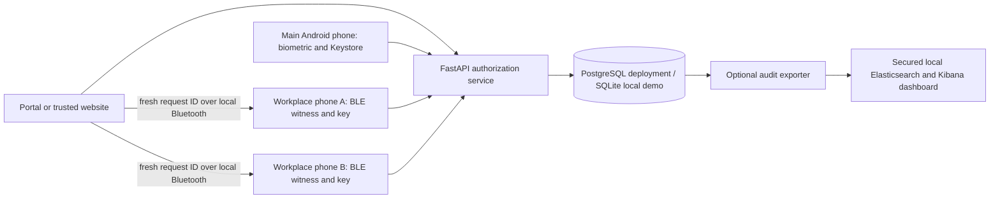

# Unified Credentials Manager: technical report draft

**Status:** November 3, 2026. The software and local lab evidence below are recorded; the three-phone, public HTTPS, and final network-security results still require execution. Replace this status and fill the physical results before submission.

Against the eight synopsis modules, seven now have a demonstrated local lab flow. The identity-verification software and emulator path works, while its real-phone proof remains open. This is a scoped lab assessment, not a production-security score.

## Abstract

Unified Credentials Manager (UCM) is a self-hosted authentication portal and API that a trusted website can reuse instead of building its own password database and account controls. It implements password registration and screening, revocable server sessions, account recovery signed by an Android Keystore key, audit events, and protected resources at three trust levels. The distinctive experiment asks whether two independently enrolled workplace phones near the user's browser can raise access from remote to office level. The phones sign a fresh request after a Bluetooth contact; the backend checks all three role-specific signatures. The current local implementation proves the protocol and main-phone biometric operation on an emulator. Actual proximity and two-node Bluetooth behavior await three physical phones.

## Problem and objective

Websites commonly need registration, login, password recovery, session management, and authorization. Implementing these separately can lead to weak credential storage or inconsistent access checks. UCM centralizes those operations behind a reusable API and demonstrates integration with a separate Lab Library website. The lab objective is to build and verify a strong local authentication service using selected [NIST SP 800-63B-4](https://pages.nist.gov/800-63-4/sp800-63b.html) password practices and [OWASP ASVS 5.0](https://cornucopia.owasp.org/taxonomy/asvs-5.0) control areas. These sources are engineering targets, not a claim of certification.

The additional research question is whether a fresh main-phone approval plus two workplace-node approvals can support different access levels. UCM calls these **account**, **remote**, and **office**. The browser's visible page explains the pipeline, but only backend dependencies release the protected resources.

## Design

The web portal uses Next.js; FastAPI and SQLAlchemy implement the API and persistence; Alembic versions the schema. The active Android client is Kotlin/Jetpack Compose in Android Studio. Flutter remains a historical prototype. The portal defaults to same-origin `/api` requests, allowing one HTTPS address for the website and phones. The self-hosted deployment design uses Caddy as its HTTPS entry point; the temporary physical lab can use an ngrok tunnel. No external identity provider participates in UCM's credential check or signature decision.

## Security controls implemented

| Area | Implementation | Evidence and boundary |
|---|---|---|
| Passwords | 15–128 characters, NFC normalization, no character-class rule, local common/breach-password blocklist, Argon2id salt and work factor, five-entry history | Backend policy tests and live registration; the local index has 1,510,213 common and sampled breach hashes. A password newly flagged after registration can only open a restricted password-change session; full breach coverage is not claimed. |
| Sessions | 256-bit random opaque credential, hash-only verifier in the database, HttpOnly cookie, idle and absolute expiry, logout and per-session revocation | Backend tests and 18-check HTTP probe; Secure cookie is enabled in phone-lab and production configurations |
| Request integrity | Per-session CSRF token, Origin allowlist on writes, JSON-only credential requests, CSP script nonce and other response headers | Backend and live HTTP tests; the final-build unauthenticated ZAP scan covers public portal pages only |
| Sensitive data | AES-256-GCM for recoverable CSRF session secrets with fresh nonce and session/account associated data | Tamper tests; UCM does not claim whole-database encryption |
| Android recovery | RSA-PSS signature over a fresh five-minute challenge and new-password digest; conditional one-time consume; server session invalidation | API and Kotlin tests; main-phone enrollment, biometric signing, and reset passed on an API 36.1 emulator |
| Tiered access | Main-phone signature opens remote data; same request plus two distinct workplace-node signatures opens office data | Backend trust tests; office remains disabled in the ordinary demo pending physical tests |
| Abuse and audit | Route limits plus a database-backed account-name login throttle; security events, high-risk burst detection, administrator alert reviews, and guarded audit pruning | 51 backend tests; synthetic events reached PostgreSQL, Elasticsearch, and the saved Kibana dashboard in a local Docker rehearsal |
| Operations | Operator lost-phone recovery and workplace-node emergency revocation commands with high-risk audit events | API tests; real operator identity-check procedure and rehearsal remain |

NIST calls for rate limiting on the subscriber account and for passwords to be screened against commonly used or compromised values. The current one-minute account throttle is implemented for sequential requests across web and Android clients. Concurrent failure races and proxy-aware client addressing still require final deployment review. The project follows selected controls; it does not establish an authenticator assurance level or phishing resistance. The Bluetooth check is vulnerable to live relay attacks, so it is a presence signal rather than verified physical location.

## Reusable website demonstration

The static Lab Library example has no local password table. It asks UCM's protected endpoint for account, remote, or office notes. A second, independent [Python website example](../examples/python-website/README.md) protects its **own** backend notes using a reusable session-validation dependency. Live testing returned 401 before UCM login, 200 after login, and 401 immediately after UCM logout. These examples prove integration for a trusted same-host deployment. UCM is not an OAuth/OIDC provider and does not support arbitrary unrelated domains without further protocol design.

## Verification completed

| Evidence | Result |
|---|---|
| Backend suite in the current virtual environment | 51 passed; one upstream Starlette test-client deprecation warning |
| Portal production build and lint | Passed after same-origin rewrite |
| Local web/security rehearsal | 18 HTTP security checks through the portal `/api` route; 13 account/sample-site checks after backend restart |
| Dependency checks on November 3 | JavaScript production audit and Python production-requirement audit reported zero known matches. The JavaScript full audit reported 14 moderate findings in development-only lint tools. The `follow-redirects` production dependency was patched to 1.16.2. |
| ZAP unauthenticated passive scan on the final local portal build | One medium missing-CSP issue was fixed; final-build rerun reports zero alerts; scanner-log diagnostics were traced to missing Firefox/geckodriver and a slow update-check rule |
| ZAP authenticated API requestor check | Ten routes, including two guarded POSTs, checked with a disposable bearer session; zero passive alerts; session revoked and report credential-free |
| Android API 36.1 emulator | Main-phone enrollment, biometric login approval, signed password reset, node-code claim, and BLE advertising observed |
| Docker Compose lab stack on October 30 | PostgreSQL-backed login and events reached Elasticsearch; Kibana dashboard saved and re-imported |
| Secured monitoring overlay | A local PostgreSQL/Caddy/Elasticsearch/Kibana stack indexed six synthetic events over authenticated TLS. Unauthenticated reads returned 401; the write-only exporter key received 403 for reads. Kibana required login and imported both dashboard objects. Index retention and public deployment remain. |
| Phone-lab launcher smoke test | Same-origin registration/login/profile with a Secure cookie using a placeholder HTTPS origin; no ngrok or phones were connected |
| Independent website backend | Its own private notes returned 401 signed out, 200 after UCM sign-in, and 401 after UCM logout |
| Administrator monitoring | Cross-account page and API passed role, phone-approval, filtering, CSRF, review, and revocation checks. A disposable browser admin recorded a review and lost access after role revocation; physical phone use remains unverified. |
| PostgreSQL backup restore | Custom-format dump restored to a separate database; source and restore matched at 4 users, 4 history rows, 12 events, and Alembic revision `02ab954e12a1` |
| Self-hosted deployment definition | Local Caddy/PostgreSQL runtime passed synthetic HTTPS login and 19 security checks, a TLS 1.3 handshake, selected-port Nmap, and a TCP/443 capture; no public-domain runtime test yet |

See [progress](PROGRESS.md), [security testing](SECURITY_TESTING.md), and the [phone-lab acceptance table](PHONE_LAB.md) for exact reproduction and limits.

## Threats and limitations

Password guessing is slowed by Argon2id and online throttles, but the offline corpus cannot screen every leaked password. A copied session credential works until expiry or revocation, so HTTPS, cookie protection, and account activity review remain necessary. A live relay can carry Bluetooth contact to a distant node; challenge rotation prevents replay of an old approval but not a live relay. Node private keys are distinct, yet current enrollment does not prove they reside on different physical devices. Office access is a ten-minute grant, not a continuous location check. The original development Elasticsearch/Kibana stack disables authentication; a separate secured local overlay is available but still needs operational retention and public deployment validation.

A newly identified breached password restricts resource access and prompts a change, but knowledge of the current password still permits that change. For high-assurance deployments, require an additional verified factor for forced rotation or use a staffed recovery process. The local corpus is partial and a clean lookup is not evidence that a password is secret.

## Remaining acceptance work before final submission

1. Complete the [three-phone checklist](PHONE_LAB.md) with real hardware, switched-off node, revocation, screenshots, and audit events. Record the test distance and Android/browser versions. Do not claim precise indoor positioning.
2. Deploy to a real trusted HTTPS address, verify the certificate and cookie behavior, capture a synthetic login packet trace, and run Nmap on the authorized host.
3. Repeat authenticated portal/API scanning after the final build and investigate the saved ZAP log diagnostics. Resolve findings before signing off.
4. Extend the basic backup-restore count check to original-password and full outage recovery, apply the proposed operator identity-check policy with real people, and operate the secured Elasticsearch/Kibana overlay with investigator accounts, key rotation, index/backup retention, and an incident-response schedule. Automatic alert delivery is not implemented.
5. Update this report's status, evidence table, and conclusion with the actual physical and deployment results.

## Conclusion at this stage

UCM demonstrates an integrated authentication service and a testable contextual-access design. Local tests support its password, session, recovery, and tiered-authorization code paths, and a separate website can consume its protected resources. The strongest novelty claim is the **policy experiment** that raises access only after a fresh main-phone approval and two local workplace witnesses. Physical proximity, production transport, and operational security remain unproven until the listed acceptance tests are completed.
